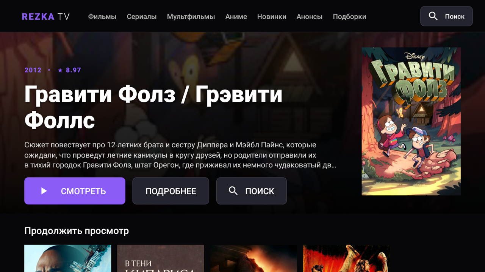
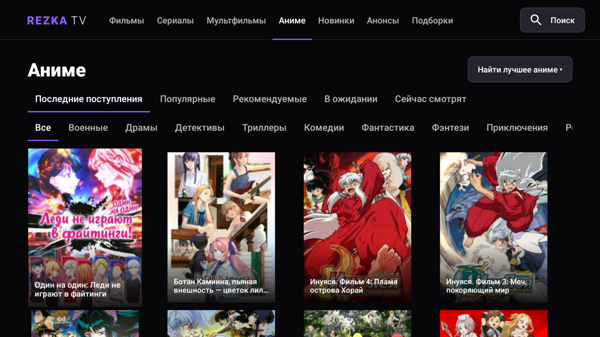
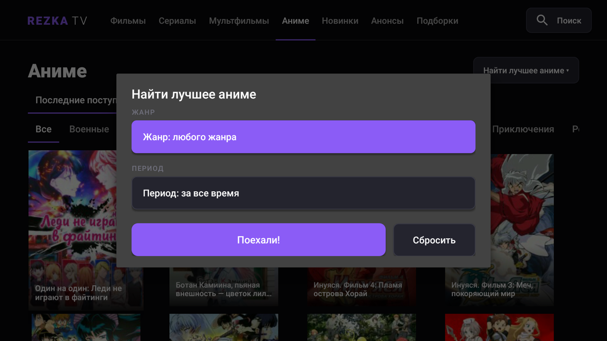
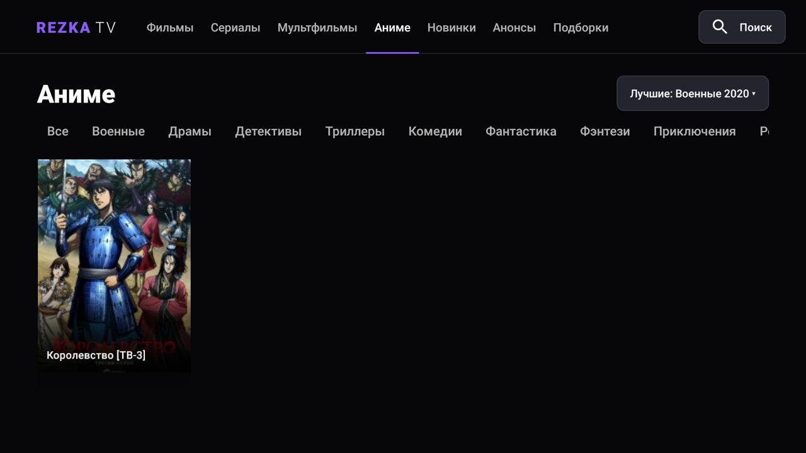
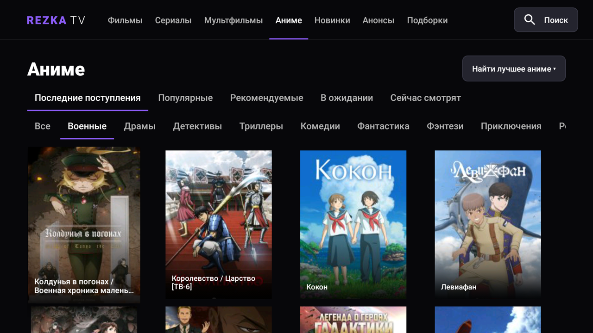
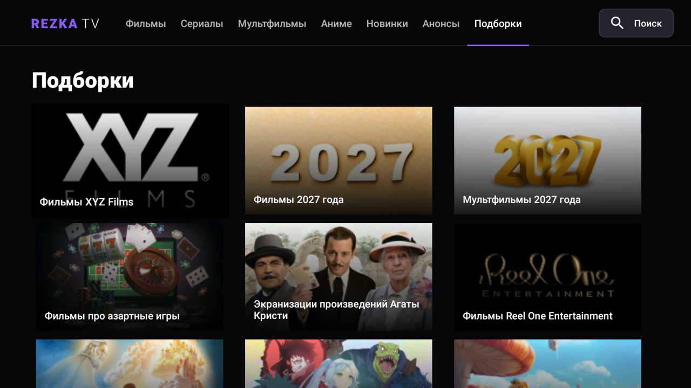
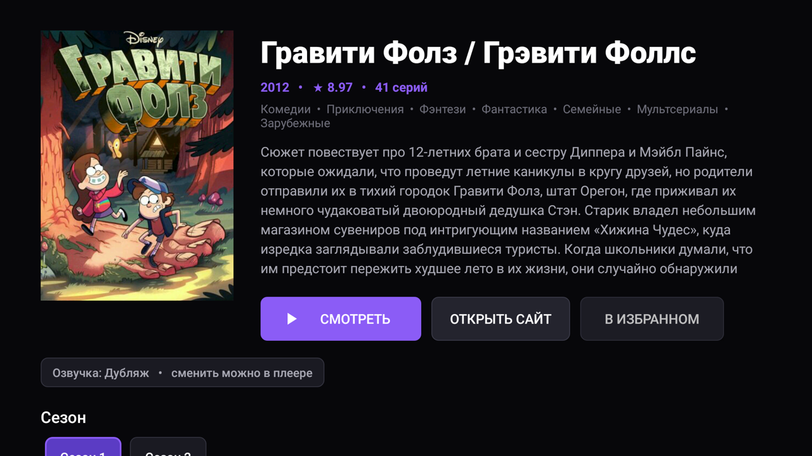
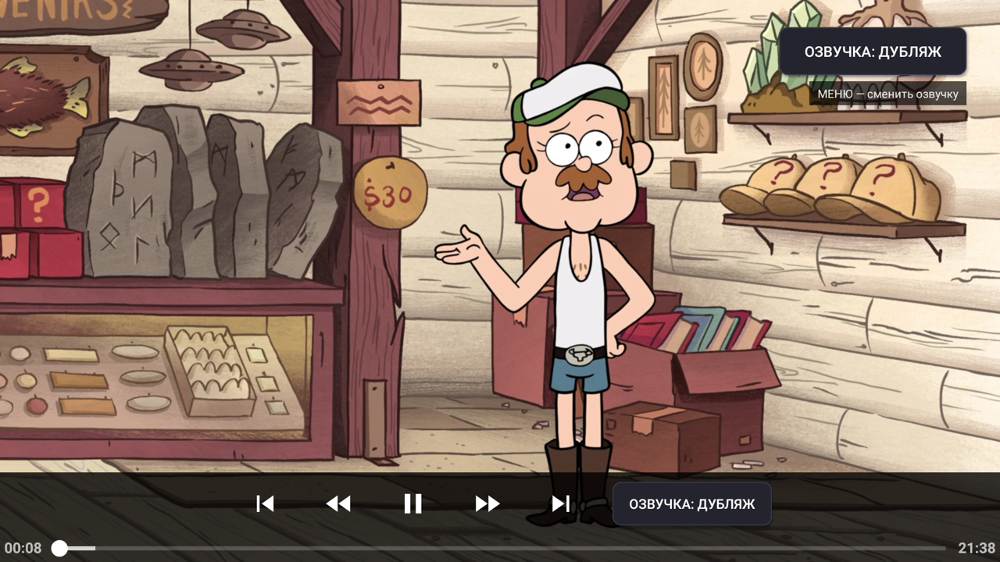
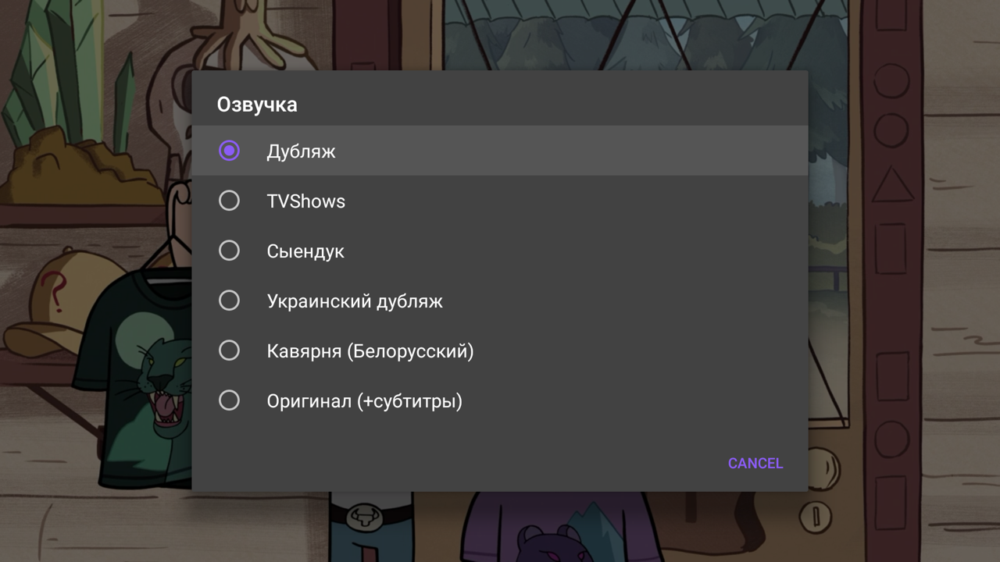

# Rezka TV — a Netflix-style, ad-free client for the Mijia Youth projector

Native Android TV client for **rezka.ag**, aimed at the **Xiaomi Mijia LED
Projector Youth Edition (MJJGTYDS02FM / MiProjLED1 / conan)**: Android 6.0.1,
API 23, Amlogic T968, armeabi-v7a, 1080p, D-pad remote, no Google Play
Services.

The app is built around the **Gravity Falls** page
(`https://rezka.ag/cartoons/comedy/1982-graviti-folz-2012.html`), which is the
hero banner and the first favorite, but the whole rezka catalogue is
available: categories, search, series, films and cartoons.

Playback is native ExoPlayer HLS. The site's player page is never loaded, so
its VAST/preroll configuration is never requested. The voiceover (озвучка)
can be changed **inside the player** while watching.

> Use it only for content you are allowed to access in your jurisdiction.

## Build

```bash
# AGP 8.7 needs JDK 17 or 21 (JDK 24 is not supported)
export JAVA_HOME="/path/to/jdk-21"
./gradlew assembleDebug
# APK: app/build/outputs/apk/debug/app-debug.apk
```

`local.properties` points at `~/Library/Android/sdk`; edit it if needed. The
project expects platform 35.

## Install on the projector

```bash
# one command: connect, install, launch
./tools/install.sh 192.168.31.228:5555

# or by hand
adb connect 192.168.31.228:5555
adb install -r app/build/outputs/apk/debug/app-debug.apk
adb shell am start -n me.rezka.tv/.ui.MainActivity
```

The projector must have ADB over network enabled. If `adb connect` says
`No route to host` while the device answers ping, adbd is usually not
listening on 5555 (disabled after a reboot or the projector is in standby).
Wake it, re-enable ADB debugging, or connect USB and run `adb tcpip 5555`.

Deep link:

```bash
adb shell am start -a android.intent.action.VIEW \
  -d "https://rezka.ag/cartoons/comedy/1982-graviti-folz-2012.html" \
  me.rezka.tv
```

## UI

* Full-screen hero for Gravity Falls with the full 2:3 poster, rating,
  year and description.
* **Navigation in the style of rezka.ag.** A dark header with the
  **REZKA TV** logo, the site sections **Фильмы · Сериалы · Мультфильмы ·
  Аниме · Новинки · Анонсы · Подборки**, and **Поиск** on the right. The
  current section is underlined; the logo returns home. No pills, no drawer,
  nothing overlaps the posters.
* Category pages keep the site's structure:
  * sort tabs from the category page — **Последние поступления /
    Популярные / Рекомендуемые / В ожидании / Сейчас смотрят**
    (`?filter=last|popular|soon|watching`);
  * the section's **genre tabs** exactly as in the site menu (for Аниме:
    Военные, Драмы, Детективы, …, Махо-сёдзё, Меха), each opening
    `/animation/{genre}/`;
  * **Найти лучшее аниме** / **Найти лучшие фильмы** / **Найти лучшие
    сериалы** / **Найти лучшие мультфильмы** opens the site's two selects —
    **Жанр** and **Период (год)** — with **Поехали!** and **Сбросить**. The
    result is the ranked page `/animation/best/{genre}/{year}/`, and the
    button shows the active filter (e.g. «Лучшие: Военные 2020»).
* **Подборки** opens the collections index; a collection opens its own
  title grid.
* Horizontal rows on the home: “Продолжить просмотр”, “Избранное”,
  “Сейчас на сайте”, “Мультфильмы”, “Сериалы”, “Фильмы”.
* Detail screen with poster, description, genres, season chips and episode
  chips.
* Player: ExoPlayer HLS, resume position, next/previous episode on
  `MEDIA_NEXT` / `MEDIA_PREVIOUS` (or channel up/down), auto-next, custom
  seek overlay, and an **Озвучка** chip.
* Search screen (the **Поиск** button in the header).

## Voiceover selection (озвучка)

The player shows an **Озвучка: <name>** chip in the top-right corner while
the controls are visible. Press **MENU** on the remote (or **UP** while
watching) to open the list; the chip itself is clickable with a touch/air
mouse. The list contains every dub the site offers for the current title
(for Gravity Falls: Дубляж, TVShows, Сыендук, Украинский дубляж, Кавярня,
Оригинал (+субтитры)). Move with the D-pad and press OK.

Selecting another dub:

1. fetches that voiceover's episode list from
   `/ajax/get_cdn_series/` (`action=get_episodes`),
2. finds the same season/episode (a merged “20-21” episode is matched by its
   label range),
3. resolves the new signed HLS stream and **continues at the same playback
   position**.

The same menu is available when playback fails, so a premium-only dub can be
skipped without leaving the player. Dolby/audio-track selection inside one
stream is not needed: on rezka every dub is a separate stream.

## How the Anubis gate is handled

rezka.ag is protected by **Anubis** (proof-of-work anti-bot). `net/Anubis.java`
implements the same algorithm as Anubis v1.27's Web Worker:

1. read the `anubis_challenge` JSON from the challenge page,
2. find a `nonce` such that `SHA-256(randomData + nonce)` starts with
   `difficulty` hex zeroes (usually 2 → ~256 hashes, milliseconds),
3. call `/.within.website/x/cmd/anubis/api/pass-challenge` with the hash and
   nonce.

`net/Http.java` owns a process-wide `CookieManager`, detects the challenge on
any response and retries the original request once. The resulting auth
cookie is valid for 30 days and is re-acquired automatically after it
expires, so no browser or WebView is involved in the normal path.

## How ad filtering works

1. **Native path (preferred).** Playback resolves a signed
   `stream.voidboost.one` HLS URL from the AJAX endpoint and hands it directly
   to ExoPlayer. The page's ad scripts, VAST tags and `franecki.net` vectors
   are never loaded.
2. **WebView fallback.** `WebActivity` intercepts requests and blocks the
   hosts in `app/src/main/assets/blocklist.txt`, injects
   `assets/adblock.js`, hides leftover ad containers and kills popunders.
   This is a last resort; WebView 56 on the projector cannot run Anubis's ES
   module anyway.

The filter is per-app; no system-wide VPN is installed.

## Source layout

| Path | Purpose |
|---|---|
| `net/Http.java` | gzip-aware HTTP + cookie jar + Anubis retry |
| `net/Anubis.java` | proof-of-work solver |
| `net/RezkaClient.java` | catalogue, search, details, voiceovers, stream resolver |
| `net/AdBlock.java` | host/path blocklist engine |
| `net/Tls.java` | adds ISRG Root X1/X2 to the Android 6 trust store |
| `ui/MainActivity.java` | hero, header, rows |
| `ui/CategoryActivity.java` | sort tabs, genre tabs, «Найти лучшее» filters, grid |
| `ui/DetailActivity.java` | details, seasons, episode picker |
| `ui/PlayerActivity.java` | ExoPlayer, resume, next/prev, **озвучка switcher** |
| `ui/SearchActivity.java` | search grid |
| `ui/WebActivity.java` | ad-blocked WebView fallback |
| `ui/CollectionAdapter.java` | wide cards for Подборки |
| `ui/TopNav.java` / `TopNavAdapter.java` | rezka.ag-style header |
| `ui/SortAdapter.java` | sort and genre plain-text tabs |
| `ui/ChoiceAdapter.java` | season / best-of chips |
| `ui/ImageLoader.java` | LruCache + disk poster cache |

## Stream notes

* The AJAX `url` field is a PlayerJS stream list:
  `[360p]https://…/file.mp4:hls:manifest.m3u8 or https://…/file.mp4,…`.
  The resolver picks the highest non-premium quality up to 1080p and uses the
  HLS variant (the literal `…:hls:manifest.m3u8` URL is the m3u8 manifest).
* `Referer: https://rezka.ag/` is required by the CDN; the player sets it on
  every request.
* Films do not support the episode AJAX call. Their page ships the signed
  streams inline (`initCDNMoviesEvents`), and each voiceover has a page
  variant (e.g. `/films/…/47-viruseproject.html`). The resolver handles both.
* Premium-only voiceovers have no playable URL; the player reports the error
  and offers the озвучка menu again.

## Compatibility notes

* `minSdk 22`, `targetSdk 23` (Android 6.0): all permissions used are normal
  permissions, so no runtime dialogs appear on a remote-controlled TV.
* ExoPlayer **2.18.7** (not Media3) for API 23 compatibility.
* Hardware decoding is delegated to `MediaCodec`; the Amlogic decoders are
  `OMX.amlogic.avc.decoder.awesome` and `OMX.amlogic.hevc.decoder.awesome`.
* `Tls.install()` is essential on the 2017 trust store: the site and its CDN
  chain to Let's Encrypt ISRG Root X1/X2.
* The scraper depends on rezka HTML/JSON shapes. If the site changes, update
  the patterns in `RezkaClient`.

## Verified

Android TV 12 emulator (API 31, arm64) and the Mijia Youth projector
(Android 6.0.1):

* Home loads, Anubis is solved transparently.
* The rezka.ag-style header switches between Фильмы / Сериалы / Мультфильмы /
  Аниме / Новинки / Анонсы / Подборки; the active section is underlined.
* Аниме shows the site's sort tabs, the full genre row (Военные … Меха) and
  «Найти лучшее аниме» with Жанр + Период + Поехали.
* Applying Военные + 2020 opens `/animation/best/military/2020/` and labels
  the button «Лучшие: Военные 2020»; Сбросить returns to the normal section.
* Подборки lists collections; a collection opens its own title grid.
* Gravity Falls detail shows two seasons and 41 episodes (Дубляж).
* Playback starts at 480p HLS with `c2.goldfish.h264.decoder` (emulator) and
  the Amlogic decoder (projector), no pre-roll.
* MENU/UP opens the player's Озвучка dialog with all six dubs (checked item
  follows the current dub); switching re-resolves the same episode, updates
  the chip and keeps the position (verified: Дубляж 20:41 → TVShows 21:34 at
  the same scene).
* `MEDIA_NEXT` / on-screen ⏭ moves to the next episode.

## Live emulator view with a D-pad remote

`tools/tv_live.py` serves the running emulator framebuffer and a clickable
remote:

```bash
python3 tools/tv_live.py
# open http://127.0.0.1:8765/
```

Every click becomes `adb shell input keyevent` / `input tap` on
`emulator-5554`.

## Screenshots

| | |
|---|---|
|  |  |
| Home: rezka.ag-style header + hero | Аниме: sort tabs, genre tabs, «Найти лучшее» |
|  |  |
| «Найти лучшее аниме»: Жанр + Период | «Лучшие: Военные 2020» |
|  |  |
| Genre tab: Военные | Подборки |
|  |  |
| Gravity Falls details | Player + Озвучка chip |
|  | |
| Озвучка list | |
